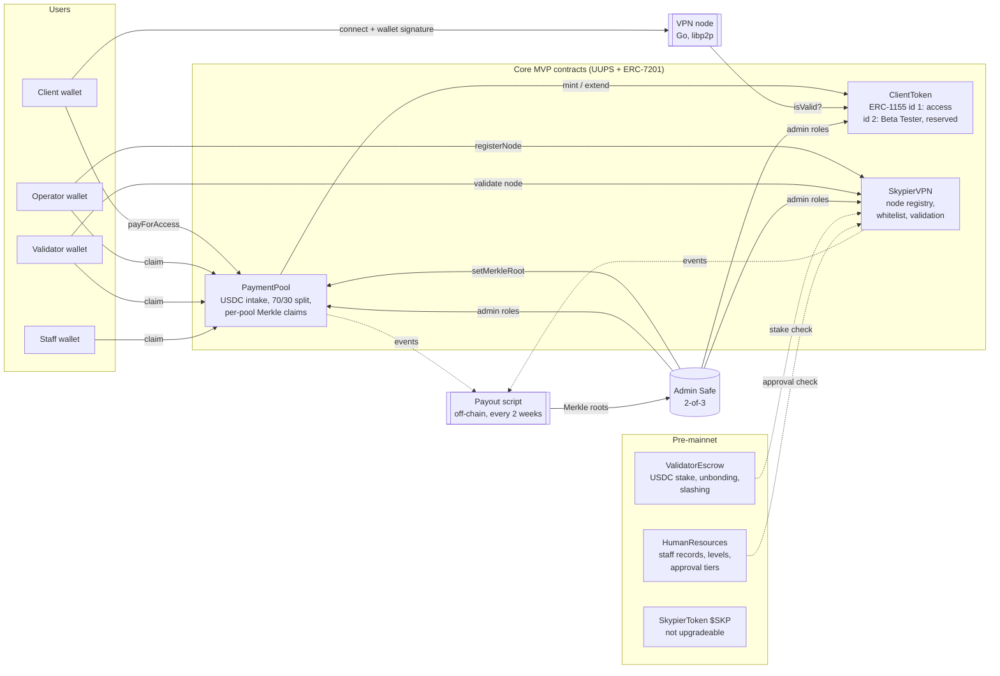
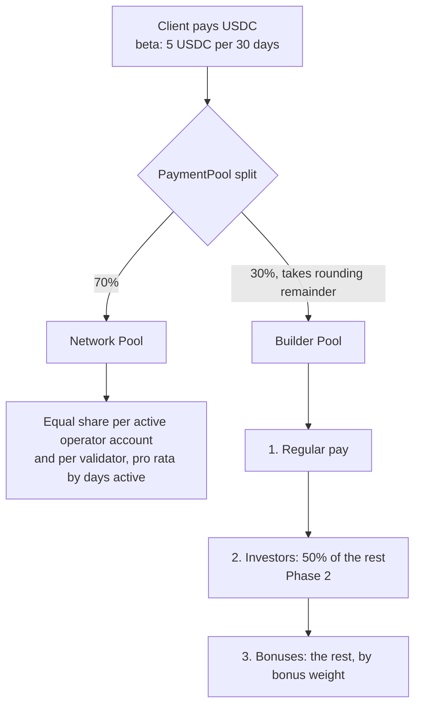

# Skypier Smart Contracts

Smart contracts for Skypier, a decentralized VPN built on libp2p. Clients pay in USDC on Base. Independent operators run VPN nodes and are paid from that revenue. Staff are paid from a separate pool.

> **Status:** design v2, Core MVP in development for Base Sepolia (testnet).
> **Source of truth:** the Skypier "Smart Contract Development" spec in Notion (Version 2.0). This README is a snapshot of it as of 2026-11-23. If they disagree, the spec wins.

---

## Contents

1. [Architecture](#architecture)
2. [Contracts](#contracts)
3. [How money moves](#how-money-moves)
4. [Roles and permissions](#roles-and-permissions)
5. [Phases](#phases)
6. [Decisions and reasons](#decisions-and-reasons)
7. [Repository layout](#repository-layout)
8. [Build and test](#build-and-test)
9. [Security notes](#security-notes)

---

## Architecture



Solid lines are the Core MVP. Dotted lines from `ValidatorEscrow` and `HumanResources` arrive before mainnet.

Design rules:

- **Roles, not badge tokens, for permissions.** OpenZeppelin `AccessControlUpgradeable`. Only the Client token and badges are tokens.
- **Nothing loops over recipients on-chain.** Payouts are computed off-chain and claimed against one Merkle root per pool.
- **Upgradeable except the token.** UUPS proxies with ERC-7201 namespaced storage. `SkypierToken` is not upgradeable, so it ships complete.
- **Contracts talk through public interfaces,** never shared storage.
- **The Safe holds every admin role.** The deployer keeps none.

---

## Contracts

| Contract | Does | Upgradeable | Phase |
| --- | --- | --- | --- |
| `ClientToken` | ERC-1155. Id 1 `CLIENT_TOKEN` (paid access, expires); id 2 `BETA_TESTER_BADGE` (reserved). Only the Safe can transfer. `isValid(account, id)` | UUPS | Core MVP (id 2 in Phase 2) |
| `PaymentPool` | `payForAccess(units, maxPayment, referrer)`; splits USDC 70% Network Pool / 30% Builder Pool; one Merkle root per pool; cumulative claims; pause | UUPS | Core MVP |
| `SkypierVPN` | Operator whitelist, `registerNode(peerId, referrer)`, one operator per PeerID, validation by someone other than the operator, `deactivateNode`, `isOperational` | UUPS | Core MVP |
| `ValidatorEscrow` | USDC stake per node and per validator, 14-day unbonding (7–30 day bounds), slashing to the treasury | UUPS | Pre-mainnet |
| `HumanResources` | Staff records (level 1.000–6.999, work class, job family, start and departure dates, departure type), base rate, approval tiers, `offboard` | UUPS | Pre-mainnet |
| `SkypierToken` | $SKP: ERC-20 + Permit + Votes; minted only by an emissions contract; 5% yearly limit, 10% hard ceiling; 1,500,000 starting supply in the treasury | No | Pre-mainnet |

Later contracts (Phase 2): SKPC credits (ERC-7818), `SkypierBadges` (recognition badges), $SKP staking and emissions, investor ledger, sponsor vaults (ERC-4626 + ERC-721 positions), stake grant or lending, DAO, Diamond (ERC-2535) app layer, pluggable pricing.

---

## How money moves



**Every two weeks:** the payout script computes each recipient's lifetime earnings per pool. The Safe posts one Merkle root per pool. Recipients claim the difference and pay their own gas. Payout rounding remainders stay in their pool.

**Network Pool (MVP rule).** An operator account is active from the day its first node is validated until it has no operational nodes. A validator is active between `setValidatorStatus(true)` and `(false)`, except while a slash leaves its stake below the requirement.

**Builder Pool.**

1. *Regular pay* = 20 USDC/hour × 8 hours × level × days per two weeks (Full Time 9, Full Time Flex 7, Part Time 5). Pro rata in the period someone starts or leaves, or a layoff's 78 weeks end. Laid-off staff keep regular pay for 78 weeks.
2. *Investors* get 50% of what remains (Phase 2).
3. *Bonuses* go by weight. A current employee's weight is level × days ÷ 9 (pro rata in partial periods). Each active recognition badge (Phase 2) adds 1.5 (Full Time), 1 (Flex) or 0.75 (Part Time). Laid-off staff keep badge weight only. Voluntary leavers and for-cause dismissals get nothing. If the total weight is 0, the pot stays in the pool.

In the Core MVP, the payout script reads levels, work classes and dates from a payroll file the Safe signs off. `HumanResources` replaces the file in Pre-mainnet.

If the pool can't cover regular pay, everyone gets the same percentage of what they're owed. Investors and bonuses get nothing that period, and unpaid pay isn't carried forward.

---

## Roles and permissions

| Who | Can do | Phase |
| --- | --- | --- |
| Admin Safe (2-of-3: Clement, Ting, 1-of-2 recovery Safe) | Everything that moves money or stake; upgrades; slashing; departure types; new paid slots; Active investors | Core MVP |
| Full Time staff, level 5+ | Grant Builder and Developer roles into slots the Safe opened | Pre-mainnet |
| Full Time staff, level 3+ | Approve operators and validators | Pre-mainnet (Safe does it in Core MVP) |
| Staff, level 6+ | Raise levels up to 5.999, or lower them, for people below their level | Pre-mainnet |
| Any employee | Issue Beta Tester badges | Phase 2 |

No one can act on their own wallet or level. Every approval records the approver, and the Safe can reverse any of them.

**Departures** (`offboard(account, departureType)`): roles are revoked in the same transaction.

| Type | Regular pay after leaving | Bonus after leaving | Proof of employment |
| --- | --- | --- | --- |
| Voluntary | No | No | 78 weeks |
| Layoff | 78 weeks | Badge weight only, until badges expire | 78 weeks |
| For cause | No | No | Record expires at once |

---

## Phases

| Phase | Meaning | Contents |
| --- | --- | --- |
| **Core MVP** | The least that lets the network run on Base Sepolia | Safe, `ClientToken` (id 1), `PaymentPool`, `SkypierVPN`, payout script with a payroll file, staff validators without stake, node access check in the Go node ([skypier-vpn](https://github.com/SkyPierIO/skypier-vpn)) |
| **Pre-mainnet** | Required before real money; starts after two clean payout periods on the testnet | `ValidatorEscrow`, `HumanResources` and staff tiers, community validators, pricing contract and `permit`, `SkypierToken`, external audit, mainnet stake amounts |
| **Phase 2** | Designed, built after mainnet is stable | Beta Tester badge, recognition badges, SKPC, $SKP staking and emissions, $SKP payments, investors, sponsor vaults, DAO, Diamond apps |
| **Circle back** | Design not finished | Proof of bandwidth and a usage-based Network Pool, mAPR and the operator onboarding bonus, final stake asset, SLA criteria, Proof of Identity |

---

## Decisions and reasons

Current decisions only. The full log, including replaced decisions, is in the Notion spec.

### Architecture

| Decision | Why |
| --- | --- |
| Permissions are AccessControl roles, not badge tokens | Revoking a role is one transaction; v1's badge burns across contracts could fail halfway and leave access live |
| Drop ERC-6551, ERC-1238, ERC-5114 and ERC-3525 | Drafts, stalled or poorly supported; soulbound behaviour and expiry are a few lines in standard contracts |
| UUPS proxies with ERC-7201 storage | Upgrades without overwriting existing data |
| `ClientToken` holds the Client token and Beta Tester badge; a separate `SkypierBadges` holds staff badges | The badge sits with the token it adds to; customer and staff data stay apart |
| Diamond pattern only for third-party apps | Keeps third-party code away from core storage and funds |
| Foundry | Fast Solidity tests and built-in fuzz and invariant testing for solvency checks |
| Every expected change is a setting, a script change or an upgrade; only the 10% inflation ceiling is fixed | The economics will change as Skypier grows |

### Payments and payouts

| Decision | Why |
| --- | --- |
| USDC on Base; 5 USDC per 30 days in beta | Low fees make a small subscription viable |
| Price = max(A, f(A, B)); buyers pass `maxPayment` | Pricing never drops below the base that funds builders; a price change can't overcharge |
| Payouts off-chain, claimed against Merkle roots | On-chain loops hit gas limits; one failing recipient could block everyone |
| One Merkle root and balance per pool | A mistake in one pool can't drain another |
| 70% Network Pool, 30% Builder Pool | From the Launch Plan |
| MVP Network Pool: equal share per active operator account and validator, pro rata by days active | Simplest fair rule until bandwidth can be verified; no full share for a partial period |
| Active = first node validated until no operational nodes; slashed below stake = inactive | Pay starts when a node can serve traffic; slashing has the same effect on operators and validators |
| Payout rounding remainders stay in their pool | Every payout-script version handles rounding the same way |

### Staff pay

| Decision | Why |
| --- | --- |
| Level 1.000–6.999 stored on-chain, scale 1,000 | Level sets pay, so changes must be auditable |
| One base rate (20 USDC/hour); pay per day by work class (9 / 7 / 5 days per two weeks) | Simple, and matches how the team works |
| Regular pay first, then investors (50% of the rest), then bonuses | Staff pay comes first |
| Shortfall: same percentage for everyone; unpaid pay not carried forward | Avoids building up debts to staff |
| Bonus weight = level × days ÷ 9, plus per badge 1.5 / 1 / 0.75; empty pot stays in the pool | Everyone earns a bonus in proportion to time and seniority; badges reward recognised impact without raising fixed payroll |
| Pro rata in start, departure and end-of-layoff periods | Pay matches days actually employed |
| Voluntary: nothing after leaving. Layoff: 78 weeks regular pay, badge-weight bonus only. For cause: nothing | Severance is for people let go through no fault of their own; bonuses reward current contribution |
| Approval tiers at levels 3, 5 and 6; money and stake stay with the Safe; no one acts on themselves | Scales onboarding while founders keep control of money |
| 2-of-3 Safe with a recovery Safe; every approval includes a founder | Losing one key doesn't lock the Safe |

### Stake

| Decision | Why |
| --- | --- |
| Approval plus USDC stake per node; no waivers | Stops cheap fake operators; waivers would let a compromised admin add nodes with nothing at stake |
| Stake locked per node at the rate when registered | One stake can't back unlimited nodes; raising the rate doesn't knock nodes offline |
| 14-day unbonding; slashing takes unbonding stake first | No withdrawing ahead of a pending slash |
| Stake stays in `ValidatorEscrow`; slashed stake goes to the treasury | Keeps operators' money separate from Skypier's |

### Tokens (after the MVP)

| Decision | Why |
| --- | --- |
| $SKP inflationary: 5% yearly limit, 10% hard ceiling; only a DAO can change the limit | Staking returns are minted; holders can rely on the worst case |
| Starting supply 1,500,000 SKP, all in the treasury | No other allocations yet |
| Keep ERC20Votes; the treasury never delegates | The token can't be upgraded later; DAO voting will use another mechanism |
| No peg to USDC | A peg needs reserves to defend; dollar-priced credits give users stable prices instead |
| SKPC: non-transferable credit worth $0.01 of service, ERC-7818 | Stable prices; each grant has its own expiry |
| Referrer recorded once on first payment or registration; MVP referrals credited later; no BD commission | Fixed referrers can't be swapped to redirect rewards; one referral reward for everyone |

---

## Repository layout

Target layout for v2. PR #3's ERC-6551, badge-token and Hardhat/Remix files are removed.

```
src/
  interfaces/      IClientToken.sol, IPaymentPool.sol, ISkypierVPN.sol, ...
  lib/             Roles.sol, storage structs (ERC-7201)
  ClientToken.sol
  PaymentPool.sol
  SkypierVPN.sol
  ValidatorEscrow.sol      (pre-mainnet)
  HumanResources.sol       (pre-mainnet)
  SkypierToken.sol         (pre-mainnet)
test/              unit, fuzz and invariant tests per contract
script/            deployment and role handover
payout/            off-chain payout script and Merkle tree builder
```

---

## Build and test

Requires [Foundry](https://book.getfoundry.sh/). Libraries are git submodules pinned to releases: forge-std v1.17.0 and OpenZeppelin Contracts / Contracts Upgradeable v5.7.0. Compiler: solc 0.8.28.

```bash
git clone --recurse-submodules -b v2 https://github.com/SkyPierIO/smartContracts
# or, in an existing clone:
git submodule update --init --recursive

forge build
forge test            # unit, fuzz and invariant tests
forge fmt --check
```

CI runs the same checks plus Slither on every pull request.

Deployment scripts will live in `script/` once written.

---

## Security notes

- The Safe holds every admin role; the deploy script must leave the deployer with none.
- Payments and claims can be paused by the Safe.
- `ClientToken`: only `PaymentPool` holds `MINTER_ROLE`, granted by the Safe after `PaymentPool` is deployed. State is written before a mint or transfer calls the receiver's ERC-1155 hook, and every state-changing function is `nonReentrant`.
- Not audited. Don't use with real funds until the pre-mainnet phase, including an external audit, is complete.
